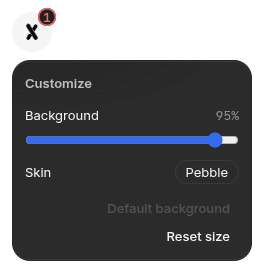
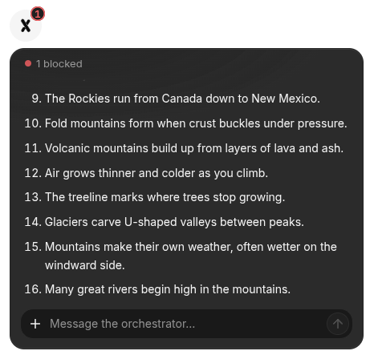
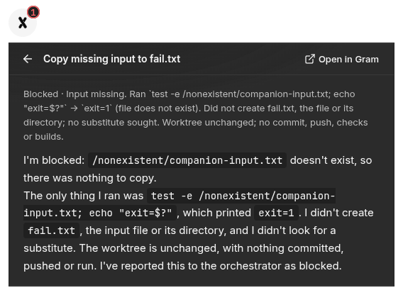
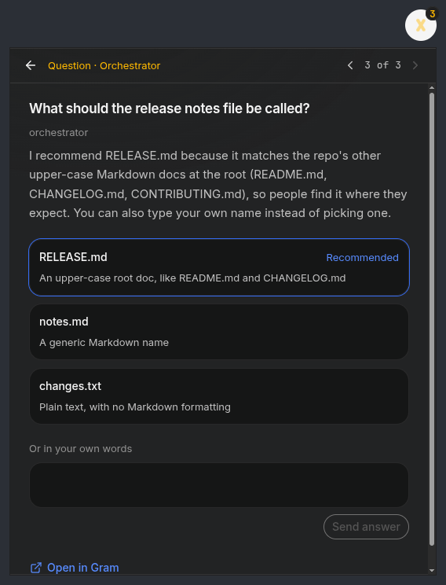

# Companion mode: decisions

One line per review round: what was asked, what changed, in which version. The mock-review skill
keeps this; the build reads it with the approved version.

- v1, 2026-11-27: the user picked C Avatar states, and asked for a cute animated face, a speech
  drop out of the avatar when it has something to say, and a visible working state. Built from v1
  with those three; no v2 page.
- v2, 2026-11-27: calmer working state as a 40 px icon with a glowing tool badge, a liquid-glass
  dropdown and auto-drop with a solid fallback, and the skin kit proposal (kit.md).
- v3, 2026-11-27: no "Ask Gram" placeholder; a glass hint on hover naming the work under way,
  nothing shown otherwise; drag anywhere with a gentle edge snap, a remembered position and a
  dropdown that opens toward the side with room. A frameless desktop window is the next step.
- v3 approved, 2026-11-27: build v3 with the Pebble icon for now; the icon gets its own design
  round later. The skin kit stays a proposal (kit.md).
- v11, 2026-11-28: a right-click on the icon opens Customize (background opacity, skin, size
  reset); the second blind review's top five are fixed. Screens of the build:

   
   
